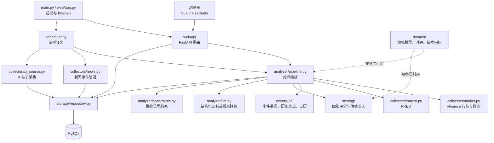
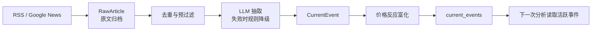
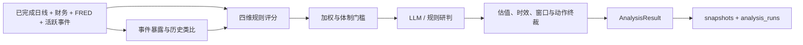

# 系统技术架构与核心数据流

> 当前代码导览（2026-10）。详细接口与算法口径见 [技术实现文档](../14-technical-implementation.md)，跨模块约束见 [模块契约](../10-module-contracts.md)，领域对象见 [核心领域模型](../02-domain-models/core-models.md)。

## 1. 核心技术架构

系统是单用户本地运行的 FastAPI 应用。`main.py` 启动 `web/app.py`；浏览器使用 `web/static/index.html` 中的 Vue 3 与 ECharts。Web API 和 APScheduler 都可触发分析；分析入口是 `analyzer/pipeline.py:run_analysis()`。MySQL 保存事件、帖子、快照和逐次分析审计。`domain/` 放跨层模型与技术指标纯函数。

| 层 | 代码入口 | 职责 |
|---|---|---|
| 入口与展示 | `main.py`、`web/app.py`、`web/api/`、`web/static/` | API、前端、启动时建表与种子事件导入 |
| 调度 | `scheduler.py` | 事件轮询、收盘分析、X 抓取、事件沉淀、月度评测 |
| 采集 | `collectors/` | yfinance、FRED、RSS/Google News、X；行情与财务使用 TTL 缓存 |
| 事件 | `events_lib/` | 原文身份、价格反应、暴露过滤、历史匹配、财报日历、自动沉淀 |
| 评分 | `scoring/` | 宏观、事件、产业、公司四维规则分；加权、门槛与估值检查 |
| 编排与研判 | `analyzer/` | 组装证据、调用 LLM 或规则降级、代码终裁、审计 |
| 领域与存储 | `domain/`、`storage/` | 共享类型和计算函数；MySQL 读写 |

## 2. 核心数据流

### 2.1 新闻事件管道

`scheduler.py` 默认每 20 分钟调用 `collectors/news.py`。原文先写入 `raw_news_articles`，之后做去重、预过滤和事件结构化；事件关联个股的价格反应由 `events_lib/reaction.py` 富化。新事件进入 `current_events`，供后续分析读取。原文和事件状态变更保留审计，避免仅凭新闻标题反复生成新事件。历史种子从 `events_lib/seed_events.yaml` 加载；自动沉淀的草稿经人工确认后才进入可匹配事件库。

### 2.2 一次股票分析

`POST /api/analysis/run`、收盘调度任务和 CLI 都调用 `run_analysis()`。每次分析重新组装证据；缓存只作用于采集请求，每日快照不代替分析输入。

1. `domain/asof.py` 确定美东决策时间与最后已完成的日线；采集池内股票、产业篮子、SPY、指数、FRED 和财务数据。
2. 从存储读取全部活跃当前事件；对每只股票先做事件暴露过滤，再检索历史事件并精排类比。X 帖子独立采集和存储，当前不参与事件分。
3. `scoring/` 产生四个 `ScoreBreakdown`：宏观、事件、产业、公司。`Engine` 按配置权重合成总分，并应用市场体制与公司短板门槛。
4. `scoring/valuation.py` 检查人工复核的估值证据。`pipeline.py` 再检查行情与财务时效、事件日期和财报窗口；证据不足时限制新增风险。
5. `analyzer/llm.py` 用分数与原始指标生成 `AnalysisResult`，不可用时由规则生成。`analyzer/constraints.py` 最终覆盖越线动作与仓位上限，LLM 不能放行估值门槛。
6. `storage/repository.py` 把逐票结果 UPSERT 到 `snapshots`，把本次完整输入与输出追加到 `analysis_runs`；Web 从这些表展示结果。

### 2.3 财报到公司评分

`MarketCollector.get_financials()` 按期末日期对齐季度营收、经营现金流和资本开支，计算季度自由现金流。`Financials.quarters` 最新在前；公司分以最近季度自由现金流率和数据齐全时的连续四季自由现金流率评估现金转化。最新季度现金流缺失时不会用旧年度现金流替代，`fundamentals_ready=0` 会限制新增风险。年度现金流仍单独保留，作为季度报表完全缺失时的旧口径。计算细节见 [公司评分](../05-scoring/company-score.md)。

## 3. 核心领域模型

领域模型统一定义在 `domain/`，跨采集、评分、分析和 API 传递。最重要的关系是：`StockConfig` 指定股票池与可选估值证据；采集得到 `DailyBar`、`Financials`、`MacroPoint`；`CurrentEvent` 与 `HistoricalEvent` 经匹配产生 `EventMatchResult`；四维分组成 `FourDimScores`；终裁后的 `AnalysisResult` 包含每只股票的 `TickerSignal`。字段、日期语义与对象关系见 [核心领域模型](../02-domain-models/core-models.md)。

## 4. 关键边界

- 总分用于研究排序；是否允许加仓还取决于估值、数据时效、市场体制和事件窗口。
- 财务数据来自 yfinance 的季度报表与年度报表，尚非 SEC 多年财报库；新财报可能在数据源更新前暂时缺失。
- X 帖子已采集入库，情绪打标与评分接入尚未实现；产业面 AI 词频腿也尚未接入。
- 完整实现、失败降级、数据库表与 API 清单见 [技术实现文档](../14-technical-implementation.md)。
