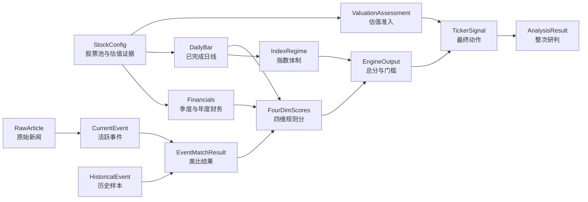

# 核心领域模型与对象关系

> 以 `domain/` 当前 Pydantic 模型为准。本文说明跨模块传递的对象及其业务含义；完整字段约束看对应源码。系统调用链见 [技术架构与数据流](../01-overview/architecture.md)。

## 1. 模型关系

图中箭头表示数据流与生成关系，不代表模型之间都存在嵌套字段。例如 `Financials` 与 `DailyBar` 是以 ticker 为键分别采集，再由分析编排层汇合。

## 2. 输入与市场证据

| 模型 | 文件 | 关键字段和作用 |
|---|---|---|
| `StockConfig` | `domain/stock.py` | `symbol`、产业 `segment`、持仓状态 `position`、可选 `ValuationEvidence`；来自 `config_files/stocks.yaml` |
| `DailyBar` / `MarketQuote` | `domain/stock.py` | 日线 OHLCV / 当前报价。分析只使用决策时钟允许的已完成日线；MA、RSI 等由 `domain/technicals.py` 计算 |
| `QuarterlyFinancials` | `domain/stock.py` | 一个 `period_end` 对应的营收、经营现金流、资本开支和自由现金流；缺失保持 `None` |
| `Financials` | `domain/stock.py` | `quarters` 最新在前，另有 `revenue_yoy`、毛利率、ROE、PE、年度现金流、净债务、采集时间与来源；季度和年度现金流是不同口径 |
| `MacroPoint` | `domain/scoring.py` | FRED 单系列观测值、前值与去年同月值；用于宏观规则分 |
| `IndexLevel` / `IndexRegime` | `domain/scoring.py` | 指数收盘与 MA200、VIX、费半 ATR；用于市场体制门槛 |
| `AnalysisClock` | `domain/asof.py` | UTC 决策时点、模式、最后可使用的交易日线日期；防止盘中未来数据进入收盘分析 |

`Financials.quarters` 按季度期末日期匹配营收与现金流。`free_cash_flow = operating_cash_flow − capital_expenditure`，其中资本开支存为正数。最新季度现金流缺失时，评分不会把年度 FCF 当成这个季度的数据。详见 [采集口径](../03-collectors/market.md)与[公司评分](../05-scoring/company-score.md)。

## 3. 事件证据与历史类比

| 模型 | 文件 | 关键字段和作用 |
|---|---|---|
| `RawArticle` | `domain/events.py` | 新闻来源、原文 URL、标题、发布时间和抓取时间；原文先归档，供事件来源审计 |
| `CurrentEvent` | `domain/events.py` | 当前事件的身份、标题、摘要、影响标的、证据、价格反应与 `status`；只取 active 事件参与分析 |
| `PriceReaction` | `domain/events.py` | 事件关联标的的事件日涨跌、此前趋势、回撤、量比与观测日期；富化事件证据 |
| `HistoricalEvent` / `TickerImpact` | `domain/events.py` | 历史样本事实、传导机制、受影响标的、回撤与恢复时长、事件前状态及来源；来自种子、人工或自动沉淀 |
| `EventMatchResult` | `domain/events.py` | 当前事件对历史样本的相似度、方向、强度及差异；匹配前先检查标的暴露 |
| `XPost` | `domain/events.py` | 已抓取的 X 帖子、回复关系与提及标的；当前未参与事件评分 |

`CurrentEvent.occurred_date` 可以为空；`reference_date` 按事件发生日、原文发布日期、抓取日期依次回退，并记录 `date_basis`。`impact_date` 可使用合并事件延续的影响开始日期。历史事件的 `TickerImpact.magnitude=0` 表示价格影响待核验，不驱动事件分。种子与人工确认的历史事件参与匹配；自动沉淀草稿需核对后转正。

## 4. 评分、估值和最终信号

| 模型 | 文件 | 关键字段和作用 |
|---|---|---|
| `ScoreBreakdown` | `domain/scoring.py` | 单维 0–100 分、原始指标、理由、缺失降级说明 |
| `FourDimScores` | `domain/scoring.py` | 宏观、事件、产业、公司四个 `ScoreBreakdown` |
| `EngineOutput` | `domain/scoring.py` | 加权总分、分档、体制与公司门槛、仓位上限系数 |
| `ValuationEvidence` | `domain/valuation.py` | 用户提供且人工复核的估值方法、保守价值、有效期、安全边际要求、假设与来源 |
| `ValuationAssessment` | `domain/valuation.py` | 代码计算的准入状态与 `allows_add`，例如 `missing`、`expired`、`passed` |
| `TickerSignal` | `domain/signal.py` | ticker、四档动作、置信度、理由、风险、仓位上限和估值评估 |
| `AnalysisResult` | `domain/signal.py` | 一次分析的时间、市场摘要、每股 `TickerSignal` 和固定免责声明 |

`EngineOutput` 的分档是规则参考。LLM 或规则降级器生成初始 `AnalysisResult` 后，`analyzer/constraints.py` 按估值、数据完整性、事件窗口和市场体制再次约束动作与仓位。最终 `TickerSignal.valuation` 由代码覆盖，不能由模型自行判定。默认四维权重各 25%，配置文件可调整但总和必须为 1。

## 5. 持久化边界

`Financials`、日线、宏观、事件和类比结果会序列化进每次 `analysis_runs` 的审计输入；`AnalysisResult` 同步记录为审计输出。`snapshots` 按美东日期与 ticker UPSERT，主要供面板展示。`current_events` 保存活跃事件，`events` 保存历史样本，`raw_news_articles` 保存新闻原文，`event_changes` 保存事件状态变更。数据库表结构见 [存储层](../07-storage/README.md)。
