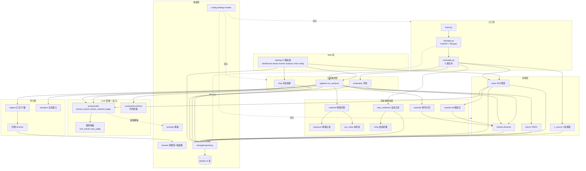
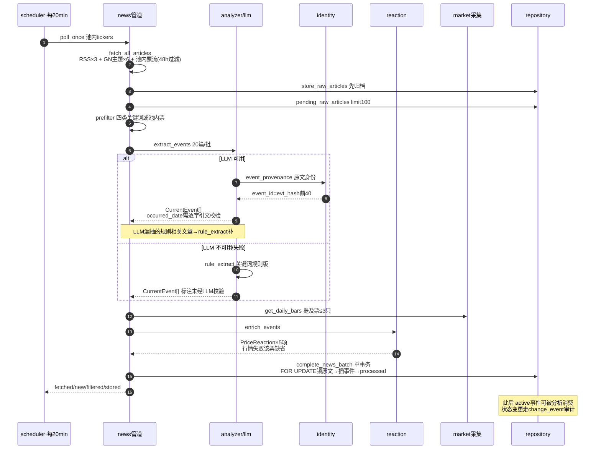
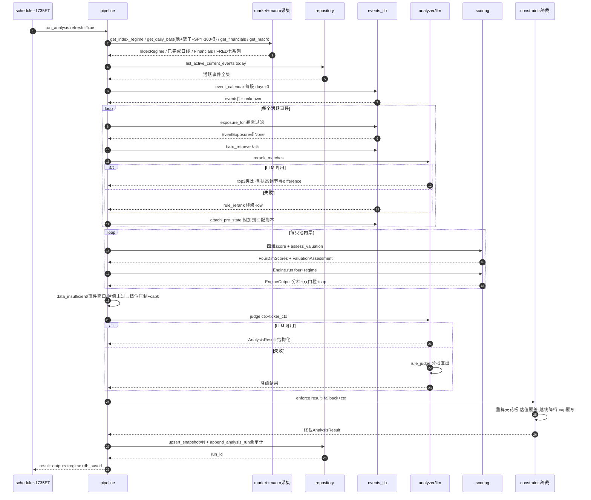
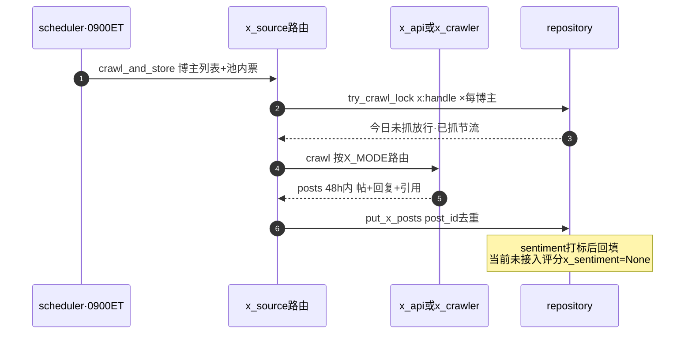
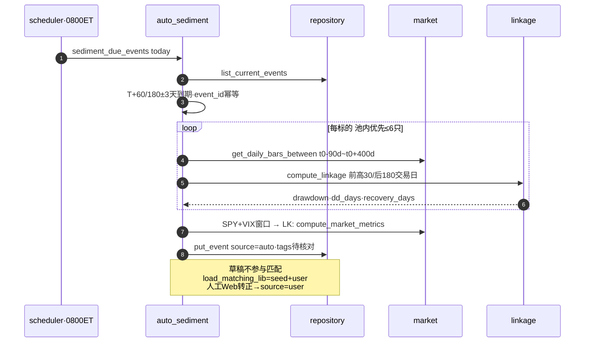
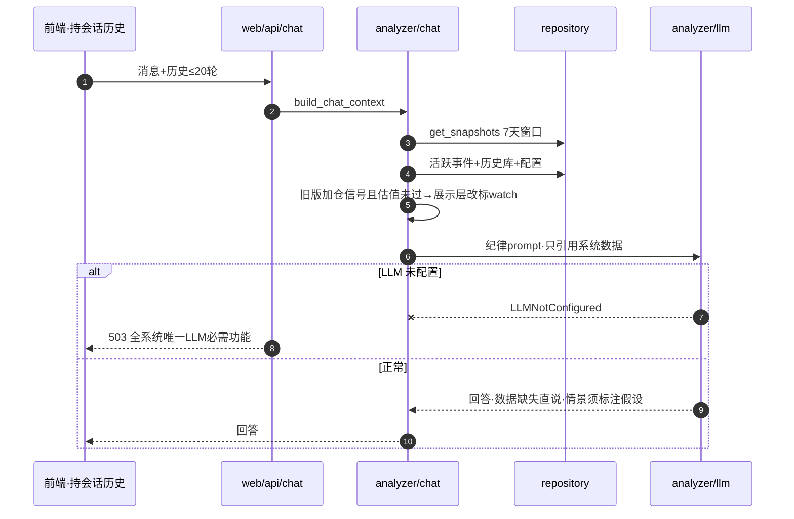
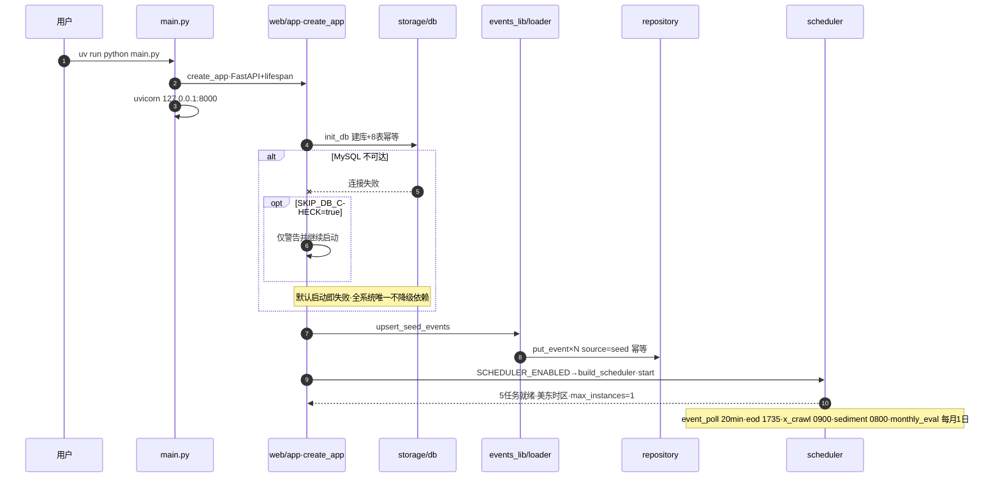
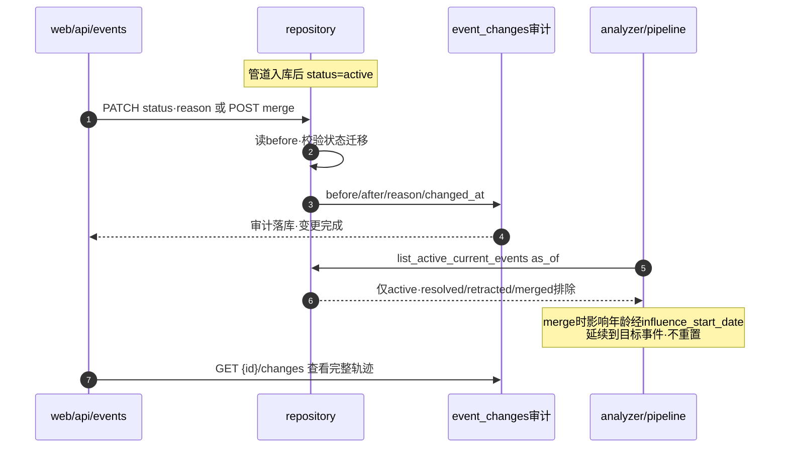
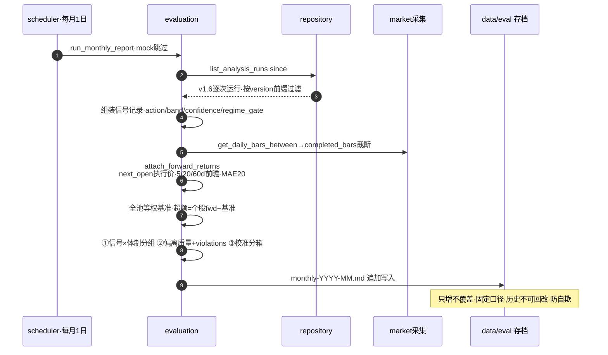
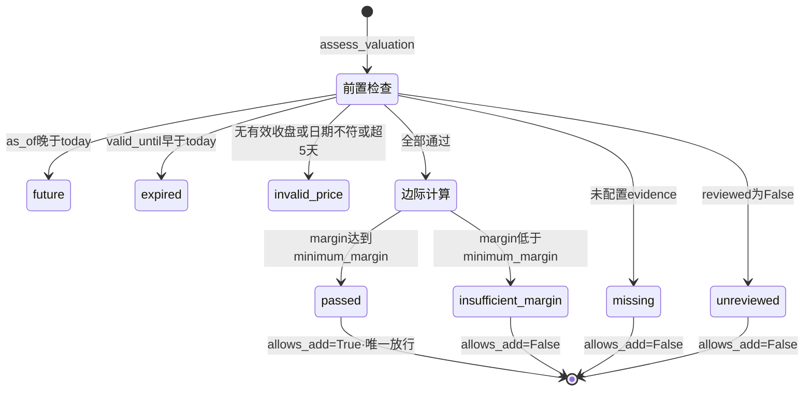

# 14-技术实现文档(详版:核心接口、数据流与算法口径)

> **定位**:面向实施者/二开者的代码级导览。所有签名、公式、阈值、降级行为均逐一对照 v1.6-a 源码核实(2026-10,dev 分支)。与 [10-module-contracts.md](10-module-contracts.md) 互补:契约管接缝规范,本文管实现事实(含公式与边界行为)。
> **约定**:`§` 引用本文小节;`模块/文件.py` 为项目相对路径;所有日期/时间未注明处均为美东(ET)。

从整体设计入手请先看 [系统技术架构与核心数据流](01-overview/architecture.md) 和 [核心领域模型](02-domain-models/core-models.md)。

## 目录

1. [运行时架构](#1-运行时架构)
2. [调度任务](#2-调度任务)
3. [核心数据流](#3-核心数据流)
4. [评分体系详解](#4-评分体系详解)
5. [事件匹配引擎](#5-事件匹配引擎)
6. [决策约束与终裁](#6-决策约束与终裁)
7. [LLM 层](#7-llm-层)
8. [评测体系](#8-评测体系)
9. [存储层](#9-存储层)
10. [Web API](#10-web-api)
11. [配置参考](#11-配置参考)
12. [技术指标纯函数](#12-技术指标纯函数)
13. [降级协议总表](#13-降级协议总表)
14. [接口清单](#14-接口清单)
15. [已知边界](#15-已知边界)

---

## 1. 运行时架构

### 1.1 进程模型

单进程:`uv run python main.py` → uvicorn 起 FastAPI(`127.0.0.1:8000`)。`web/app.py:create_app()` 的 lifespan:

1. `storage.db.init_db()`:幂等建库建表(8 张)+ `upsert_seed_events()` 种子入库。MySQL 不可达时**默认启动即失败**(全系统唯一不降级依赖);`SKIP_DB_CHECK=true` 时仅警告继续(供无库演示);
2. `settings.scheduler_enabled` 为真时 `build_scheduler().start()`(§2)。

### 1.2 采集基座(collectors/base.py)

```python
@runtime_checkable
class DataSource(Protocol):
    name: str                      # 状态页/日志用

def network_retry(fn) -> Callable  # tenacity:共3次尝试,指数退避(2~30s),耗尽抛原异常

def ttl_cache(prefix: str, ttl_seconds: int, disk: bool = True) -> Callable
```

`ttl_cache` 两级缓存:内存 dict(线程锁)+ 磁盘 pickle(`data/cache/{prefix}_{key}.pickle`,键 = 参数 repr 的 sha256 前 16 位,重启后仍可命中;损坏缓存直接删除)。各源 TTL:行情 15min、区间行情 24h、FRED 12h、财务 12h、财报日 12h。事件管道不走缓存(靠 hash 增量去重)。

### 1.3 决策时钟(domain/asof.py)

```python
analysis_clock(mode="eod", now=None) -> AnalysisClock   # {decision_at(UTC), mode, price_session_limit}
completed_bars(bars, clock) -> list                     # 剔除 bar.date > price_session_limit 的未完成日线
```

规则:以 **17:00 ET 为日线完成保守截止**(早于官方收盘数据处理时间);eod 模式落在工作日 9:30~17:00 之间时**自动转 `intraday_observe`**(盘中只观察,§6);`price_session_limit` = 当前日期(已过 17:00)或前一自然日。

### 1.4 MOCK_MODE

`collectors/__init__.py` 工厂 `get_market()/get_macro()/get_news()` 按 `settings.mock_mode` 路由到 `collectors/mock.py` 的 Mock 实现,接口同构。

### 1.5 模块交互图

> Mermaid 图(GitHub 原生渲染);调用关系与函数名均与源码一致。

#### 图 0|组件分层与依赖总图



#### 图 A|事件管道时序(默认每 20min)



#### 图 B|收盘分析主链时序(决策核心,周一~五 17:35 ET)



#### 图 C|X 采集时序(每日 09:00 ET)



#### 图 D|历史沉淀闭环时序(每日 08:00 ET + 手动挖掘)



#### 图 E|对话助理时序(POST /api/chat)



#### 图 F|服务启动时序(uv run python main.py)



#### 图 G|事件生命周期管理时序(状态变更与合并)



#### 图 H|月度评测闭环时序(每月 1 日 10:00 ET)



#### 图 I|估值准入状态机(scoring/valuation.py,唯一放行加仓的判定)



#### 表-模块读写矩阵(谁写哪张表、谁读哪张表)

| 表 | 写入方 | 读取方 |
|---|---|---|
| `current_events` | news 管道(`complete_news_batch`) | pipeline(活跃事件)、auto_sediment、web/events |
| `raw_news_articles` | news 管道(`store_raw_articles`,processed_at 回写) | news 管道(`pending_raw_articles` 重试语义) |
| `events`(历史库) | loader(seed upsert)、auto_sediment(auto 草稿)、web/lib(PUT,user) | matcher(`load_matching_lib`=seed+user)、pipeline、chat |
| `x_posts` | x_source(`put_x_posts`)、`mark_sentiment` 回填 | 情绪接入前的展示(评分未消费) |
| `snapshots` | pipeline(`upsert_snapshot`) | dashboard、chat(7 天)、evaluation(legacy 口径) |
| `analysis_runs` | pipeline(`append_analysis_run`) | evaluation(v1.6 主数据源)、web/analysis/history |
| `crawl_state` | `try_crawl_lock` | 同左(节流判定) |
| `event_changes` | `change_event`(web PATCH status / merge) | web/events/{id}/changes(审计展示) |

---

## 2. 调度任务(scheduler.py)

APScheduler `AsyncIOScheduler`,时区 `America/New_York`,`job_defaults={coalesce: True, max_instances: 1}`;任务经 `_spawn` 在守护线程执行,不阻塞事件循环。

| id | 触发 | 任务体 | 失败行为 |
|---|---|---|---|
| `event_poll` | interval `EVENT_POLL_INTERVAL_MIN`(默认 20min) | `poll_events_job` → `poll_once(tickers)`(§3.1) | 打印降级信息,原文保持待重试 |
| `eod_analysis` | cron 周一~五 17:35 ET | `run_analysis(refresh=True)`(§3.2) | 打印失败,不影响下轮 |
| `x_crawl` | cron 每日 09:00 ET | `crawl_and_store(influencers, tickers)`(§3.3) | 打印失败,明日重试 |
| `auto_sediment` | cron 每日 08:00 ET | `sediment_due_events(today)`(§3.4) | 打印失败 |
| `monthly_eval` | cron 每月 1 日 10:00 ET | `evaluation.run_monthly_report()`(§8) | 打印失败;mock 模式跳过 |

---

## 3. 核心数据流

### 3.1 准实时事件管道(collectors/news.py,默认 20min 一轮)

```
poll_once(pool_tickers) → process_articles(fetch_all_articles(...), pool)
```

| 步 | 实现 | 细节 |
|---|---|---|
| 1 抓取 | `fetch_all_articles` | 内置 RSS×3(CNBC/MarketWatch/YahooFinance 头条流)+ `NEWS_RSS_FEEDS` 自定义 + GoogleNews 主题流×6(`AI chip`/`semiconductor`/`chip export controls`/`Fed interest rate`/`data center capex`/`Nvidia`)+ 每池内票 `{ticker} stock` 流。每源取前 30 条;发布超 48h 丢弃;源间随机 sleep 0.5~1s |
| 2 归档 | `repository.store_raw_articles` | **先归档再处理**:原文幂等写 `raw_news_articles`(processed_at=NULL),之后即使 RSS 消失仍可重试 |
| 3 取待处理 | `repository.pending_raw_articles(limit=100)` | |
| 4 预过滤 | `prefilter(articles, pool)` | 命中 `PREFILTER_KEYWORDS` 四类词库(宏观/地缘/行业/企业,中英混合)或提及池内 ticker(两侧加空格的整词匹配) |
| 5 LLM 抽取 | `llm.extract_events(filtered, pool)`(§7.1) | 20 篇/批;LLM 失败→`rule_extract` 规则版 |
| 6 价格反应富化 | `events_lib.reaction.enrich_events(events, market)` | 对事件提及 ticker(≤3 只/事件,`MAX_TICKERS_PER_EVENT`)算五指标:见 §5.3 前置 |
| 7 入库提交 | `repository.complete_news_batch(pending, events)` | 单事务:FOR UPDATE 锁原文 → 批量插事件 → `processed_at=COALESCE(processed_at, now)`;回滚则原文保持待重试(§9.3) |
| 8 通知 | `_notify_macos` | `NEW_EVENT_NOTIFY=true` 时 osascript 系统通知,失败静默 |

**事件身份幂等**(`events_lib/identity.py`):`article_hash = sha256(f"{raw_url}|{title}")`;`event_id = "evt_"+hash[:40]`;`title_hash` 唯一键防同文重复入库。身份**只来自原文,永不采信 LLM 输出**。

**事件生命周期**:`active → resolved / retracted / merged`(状态变更走 `repository.change_event`,写 `event_changes` 审计);分析只消费 `list_active_current_events(as_of)`。

### 3.2 收盘完整分析(analyzer/pipeline.run_analysis,决策主链)

```python
run_analysis(refresh=False, tickers=None, mode="eod"|"intraday_observe")
  → {result: AnalysisResult, outputs: {ticker: EngineOutput}, regime, db_saved, run_id, cached, audit_input}
```

**① 取数(每路独立 try/except,失败降级标注)**

| 数据 | 调用 | 备注 |
|---|---|---|
| 体制层 | `market.get_index_regime(clock.price_session_limit)` | ^GSPC/^NDX/^SOX vs MA200 + ^VIX + ^SOX ATR14;失败→`regime=None`(§6 无知即禁手) |
| 宏观 | `get_macro().get_all()` | FRED 七系列;失败→空 dict,宏观分缺失计 50 |
| 行情 | `completed_bars(market.get_daily_bars(sym, 300), clock)` | 预取池内 + 全部产业篮子 `BASKETS[segment]` + SPY(防产业分退化为个股动量) |
| 财务 | `market.get_financials(sym)` | 逐票 best-effort；季度营收与现金流按期末日期对齐，年度现金流单独保留，字段缺失为 None |
| 日历 | `event_calendar(market, sym, today, days=3)` | FOMC 硬编码日历 + yfinance 财报日 |
| 活跃事件 | `repository.list_active_current_events(today)` | 全部 active,不按抓取窗口截断;任一 `impact_date is None` → `event_data_unknown=True` |

**② 事件匹配(逐活跃事件)**——`exposure_for` 暴露过滤(§5.4)→ `matcher.hard_retrieve(k=5)` → `llm.rerank_matches`(None 则 `rule_rerank`)→ 每事件 top-3 → `attach_pre_state` 附加历史样本前状态到**匹配副本**(跨标的共享对象不污染)。

**③ 逐票评分**(§4):四维 ScoreBreakdown + `assess_valuation`(§4.6)+ `data_insufficient` 判定(§6.2)+ `current_state`(≥60 根 K 线时算 `bias_ma200`/`drawdown_52w` 供状态调节)。

**④ 汇总与门槛**(§4.7/§6):`Engine(weights).run(four, regime)`;regime 为 None 时用 `_neutral_regime()`(伪指数 close=MA200)占位并标注"体制层无法判定,暂不增加风险"。

**⑤ LLM 研判**(§7.3):`llm.judge(ctx, ticker_ctx)` → `AnalysisResult`;LLM 失败→`rule_judge`。

**⑥ 代码终裁**(§6.3):`constraints.enforce(result, fallback, ctx, ticker_ctx)`。

**⑦ 落库(降级:DB 失败时分析照常返回,`db_saved=False`)**:逐票 `upsert_snapshot(SnapshotRow)`(含回测字段:band/regime_gate/company_gate/position_cap/valuation/decision_at/price_date/source/version)+ `append_analysis_run(audit_input, result)`(全输入含 bars/financials/macro/regime/events/matches/prompt + 全输出,只追加)。

### 3.3 X 采集(collectors/x_source.py,每日 09:00 ET)

```python
crawl_and_store(influencers, pool_tickers) -> {posts, stored, throttled, skipped, error, mode}
```

`X_MODE` 路由:`off` 直接返回空;`api`→`x_api.XApiCollector`(twitterapi.io,帖+回复+引用一次拿全);`crawl`→`x_crawler.XCollector`(Playwright 登录态)。**节流先于抓取**:`repository.try_crawl_lock(f"x:{handle}")` 每博主每天 1 次(`crawl_state` 表);入库 `put_x_posts`(post_id 去重)。X 情绪**未接入评分**(`EventScorer(x_sentiment=None)` 恒定)。

### 3.4 历史事件沉淀闭环

- **联动量化算法**(`events_lib/linkage.py`,纯函数):窗口 = T0 前 30 交易日 ~ T0 后 180 交易日;前高 = max(前 30 日收盘, T0 收盘);`drawdown` = 窗口内 max(1−close/前高)(负百分数);`drawdown_days` = T0→最低点交易日数;`recovery_days` = 最低点→重新站上前高的交易日数(窗口内未收复记 None);另算 `sp500_1w/1m`(T0 后 5/21 交易日 SPY 涨跌)与 `vix_peak`。
- **前状态口径**(`events_lib/pre_state.py`):状态 = **T0 前一交易日收盘**(不含事件日,避免污染);四字段 `pre_drawdown_52w / pre_bias_ma200 / pre_runup_20d / pre_rsi14`;前置 K 线 <21 根整体放弃;<200 根乖离为 None;<252 根回撤为 None。回填走 `get_daily_bars_between(ticker, t0−420d, t0)`,**已有值不覆盖**(人工核对优先)。
- **自动沉淀**(`events_lib/auto_sediment.py`):对 `occurred_date` 距今 **T+60 / T+180 天(±3 天容差)** 的当前事件,复用联动算法实测回填,生成 `source='auto'` 草稿(`tags` 含"待核对",`event_id="auto-{window}-{原id}"` 幂等);回填标的 = 池内优先,≤6 只;`direction` 按实测回撤符号,`magnitude` 固定 0.5。
- **匹配库口径**:`load_matching_lib() = seed + user`(**auto 草稿不参与类比**);`enrich_from_initialized_history` 用初始化历史富化(非 mock)。
- **波段挖掘**(`events_lib/mine.py`):zigzag 变体——滚动峰値更新;自峰回撤 ≥`min_dd_pct`(5%)进入回调;自谷反弹 ≥`rebound_pct`(3%)或收复峰确认结束;未收复的开放波段也输出(recovery_days=None)。产物是量化骨架,归因人工/LLM 补。

---

## 4. 评分体系详解

统一产物 `ScoreBreakdown{score 0-100, indicators: dict, rationale: str(中文规则模板), degraded: bool, degraded_note: str}`。

### 4.1 权重与分档

- 顶层四维权重:`scoring_weights.yaml`(默认 macro/event/industry/company 各 0.25),`config/loader.load_scoring_weights` 校验**合计必须 = 1.0 否则拒启**;
- 分档:`≥70 积极 / ≥50 中性偏多 / ≥30 中性偏空 / <30 防御`(`scoring/engine.band_of`);
- 缺失子腿一律**显式重归一化剩余权重**,不塞中性 50(v1.2/P1-4)。

### 4.2 宏观(MacroScorer,全池一份)

子权重 `WEIGHTS = {FEDFUNDS:.30, DGS10:.15, T10Y2Y:.15, CPIAUCSL:.20, UNRATE:.10, VIX:.10}`;单系列缺失计 50 + degraded。逐系列规则:

| 系列 | 规则(v=最新,prev=前值) |
|---|---|
| FEDFUNDS | v<prev(近3月下行,两期近似)→80;v>prev 或 v>5.0→20;否则 50 |
| DGS10 | v<prev→75;v>prev 且 v>4.5→25;否则 50 |
| T10Y2Y | v>0 且(无 prev 或 v≥prev)→75(走阔/转正);prev>v 且 v<prev<0→25(倒挂加深);v<0→40;否则 55 |
| CPIAUCSL | 同比 yoy=最新指数/去年同月−1(**必须 year_ago_value,缺失不用环比年化**);yoy>4→25;<3→75;否则 50 |
| UNRATE | v−prev≥0.2pct→35;v<4.5→75;否则 45 |
| VIX | <15→80;>25→20;否则 50 |

FRED 七系列中 `PCEPILFE / BAMLH0A0HYM2` 只作环境参考不进评分;`CPIAUCSL` 取 14 期(其余 10 期)以凑同比;`MacroPoint{value, prev_value, year_ago_value}`。

### 4.3 事件(EventScorer,逐票)

**输入预处理**:只保留 `similarity≥0.6 且 age≥0 且 magnitude>0` 的匹配;按当前事件分组(`current_event_id`),组内同一历史事件取相似度最高一条。

**类比原始分**(每条匹配):

```
weight    = similarity / Σ(组内similarity) × max(组内similarity)     # 组内归一 × 置信度
freshness = 0.5 ** (days_ago / half_life)                            # 分类型半衰期
discount  = 1.0(当前票 ∈ affected_tickers) else 0.5                   # NON_LISTED_DISCOUNT
factor    = clamp(0.5, 1.5, 1 + (当前乖离 − 历史前乖离)/100 × 0.5)     # 状态缺口调节(任一侧缺失=1.0)
贡献      = direction × magnitude × weight × freshness × discount × factor
analogy   = clamp(-100, 100, Σ贡献 × 100)
```

半衰期表(按**当前事件**性质,`current_category` 优先回退历史类型):`macro 30 / monetary 30 / regulation 45 / crisis 60 / tech 14 / 默认(企业类) 7` 天。

**合腿**:

- `x_sentiment=None`(现状):`score = clamp(50 + analogy × 0.5)`——类比腿权重 0.8→1.0 显式重归一化,degraded 标注"X 数据缺失";
- 有 X 情绪:`score = clamp(50 + analogy × 0.4 + (sentiment−50) × 0.2)`;
- 无命中:计中性 + "无事件命中(计中性)"。

indicators 记录 `类比分 / 半衰期(天) / 状态调节(x…~x…) / 情绪分 / matched`。

### 4.4 产业(IndustryScorer,逐 segment,篮子共享)

篮子映射 `BASKETS`:`custom_interconnect=[MRVL,AVGO]`、`optical=[LITE,COHR]`、`turnaround=[INTC]`、`energy_infra=[BE]`、`gpu=[NVDA,AMD]`、`foundry=[TSM]`、`equipment=[ASML,AMAT,LRCX]`、`cloud=[MSFT,GOOGL,AMZN]`、`software=[MSFT,CRM]`、`power=[CEG,VST]`、`etf=[SMH,SOXX]`;`other` 无映射→相对强弱腿剔除。

| 腿 | 权重 | 规则 |
|---|---|---|
| 相对强弱 | 40% | 篮子各票 21/63 日收益均值 − SPY 同期,两窗口再平均:≥5→85;≥2→70;≤−5→15;≤−2→35;否则 50 |
| 财报动量 | 30% | 篮子 `revenue_yoy` 中位数:≥30→85;≥10→65;≥0→50;<0→25 |
| AI 景气 | 30% | 词频环比变化 >0.1→75;<−0.1→30;否则 50(**当前恒为 None→剔除**) |

缺腿重归一化并在 rationale 标注(`权重重归一化 {w_sum}%`)。

### 4.5 公司(CompanyScorer,逐票)

| 腿 | 权重 | 规则 |
|---|---|---|
| 成长 | 40% | `revenue_yoy`:≥30→90;≥10→70;≥0→50;<0→25;缺失剔除 |
| 估值 | 15% | PE>0 且 rev_yoy>0:类 PEG=PE/rev_yoy,<1.5→75;<2.5→60;<3.5→45;≥3.5→30;**周期段(equipment/foundry)封顶 55**(低 PE 常伴盈利峰值)。无正增长:绝对 PE,<20→55;<35→50;<60→40;≥60→30(≤55 不给高分)。PE 缺失/亏损→剔除 |
| 质量 | 30% | 毛利率 50+(gm−40)×0.5(子权 .5)+ 现金转化(.3)+ ROE 50+(roe−15)×0.3(.2);缺项归一化,不视为负值 |
| 技术面 | 15% | 三层:**趋势 40% + 择时 35% + 伤害 25%**,见下;K 线 <60 根整腿剔除 |

技术面子项(`domain/technicals` 纯函数):

- **趋势** = 50 + clamp(±30, MA50 斜率×6) + (收盘≥MA50 ? +10 : −10);
- **择时**(RSI14):40~50→70(回踩买区);50~65→60;>70→45(过热不追);30~40→55;<30→35(深度超卖,需体制层配合解读);
- **伤害**(距 52 周高回撤):>−10%→60;>−25%→50;>−40%→40;≤−40%→30。

现金转化优先用最近季度 `FCF/营收`（%），映射分 `clamp(50+3×比率)`；连续四季数据齐全且季度期末连续时，现金转化分 = 最近季度映射分×60% + 四季合计 `FCF/营收` 映射分×40%。季度 FCF = 同期经营现金流 − 正数资本开支。最新季度现金流缺失时不拿旧年度值补齐；只有季度报表完全不可用时，才以年度 FCF 正负 80/20 作原有粗筛。详见 [公司评分](05-scoring/company-score.md)。

indicators 额外产出 `PE / data_coverage(5 字段非空比例) / fundamentals_ready(营收YoY+毛利率+当前可用现金转化证据全有→1)`；季度数据可用时也输出最新财季、同季现金流与季度/四季自由现金流率。

### 4.6 估值准入(scoring/valuation.py,硬门槛,LLM 不可覆盖)

```python
assess_valuation(evidence: ValuationEvidence | None, bars, today) -> ValuationAssessment
```

状态机(任一命中即返回,`allows_add` 默认 False,**仅 passed 为 True**):

| status | 条件 |
|---|---|
| missing | evidence 为 None(未配置) |
| unreviewed | `reviewed=False`(未人工复核) |
| future | `as_of > today` |
| expired | `valid_until < today` |
| invalid_price | 无有效收盘价,或 latest.date < as_of,或 today−latest.date > 5 天 |
| insufficient_margin / passed | `margin = 1 − price/conservative_value`(Decimal 精确计算);`margin ≥ minimum_margin` → passed |

`ValuationEvidence`(domain/valuation.py,`extra="forbid"`):`method ∈ {dcf, multiples, scenario, sotp}`、`conservative_value>0`、`minimum_margin ∈ [0,1)`、`assumptions/sources` 非空列表、`valid_until ≥ as_of`、`reviewed` 默认 False——全部由 pydantic 强校验,来自 `stocks.yaml`。

### 4.7 汇总引擎(scoring/engine.py)

```python
Engine(weights).run(four: FourDimScores, regime: IndexRegime) -> EngineOutput
```

1. `weighted_total = round(Σ 维度分×权重, 1)` → `band_of` 分档;
2. **公司面短板门槛**:公司分 <`COMPANY_FLOOR(35)` 且档位为"积极"→ 压"中性偏多",`company_gate_applied=True`;
3. **体制层分级约束**:`regime.regime_broken()` 为真 → 档位积极→压"中性偏多",`position_cap=0.3`(`POSITION_CAP_BROKEN`),note 记录破位指数与 VIX。

**破位判定**(`IndexRegime.regime_broken`,domain/scoring.py):

```
≥2 个指数收盘 < MA200,或 ≥1 个指数破位 且 VIX > 25
```

`EngineOutput{weighted_total, band, regime_gate_applied, regime_note, company_gate_applied, position_cap(默认1.0)}`。

---

## 5. 事件匹配引擎

### 5.1 硬检索(matcher.hard_retrieve)

库全量 O(N) 规则打分:category 相同 +10;关键词交集每词 +5;涉及标的交集每个 +8(GOOG/GOOGL 归一);月份邻近(同月或相邻,跨年 12↔1 算相邻)+3。取 top-k(生产 k=5)。**不用 embedding**:库几十条规模,硬检索+LLM 精排性价比最高;库 >~200 条再升级向量检索。

### 5.2 精排

- 规则版 `rule_rerank`:相似度 = category 一致 .3 + 关键词覆盖 .4(min(1, 交集数/min(事件词数,4))) + 标的重合 .2 + 月份邻近 .1;方向/强度沿用库内记录众数;`confidence='low'`、"未经 LLM 校验";
- LLM 版 `analyzer/llm.rerank_matches`(生产路径):读事件 summary/机制/量化影响做语义判断,`similarity ≥0.6` 要求"事件性质、传导机制、影响范围"三维都匹配(单纯关键词重合不足以支撑);**状态调节写进 prompt**:候选带历史前状态、当前事件带标的现状态(价格反应),当前更拥挤则 magnitude 上调,更超卖则下调;`difference` 必填且覆盖**事件差异+状态差异**两层;标注"价格影响未核验"的候选 magnitude 必须为 0;fizzled 对照显式标注供识别;失败返回 None → 调用方回落规则版。

### 5.3 结论合成(matcher.synthesize_analogy,库函数,生产不走)

相似度 ≥`SIMILARITY_THRESHOLD(0.6)` 聚合,平均 `avg_drawdown / avg_drawdown_days / avg_recovery_days`;**命中 n<3 只输出"样本不足(n=x<3),仅供参考"不给平均值**。生产 pipeline 直接取精排 top-3 喂 EventScorer 与"最强类比"文案。

### 5.4 暴露过滤(events_lib/exposure.py,v1.6)

```
scope=COMPANY   → 仅 tickers_mentioned 内的票(route=direct)
scope=INDUSTRY  → 仅 mentioned 内的票(route=direct,evidence 注明"产业扩散尚未核实")
scope=MACRO_POLICY / GEOPOLITICAL → 全池(route=market,"共同风险")
```

**未知的公司/产业关联不从历史案例推断**——事件只传递给原文明确关联的股票。

### 5.5 价格反应富化(events_lib/reaction.py)

对事件提及 ≤3 只票,以 `reference_date` 截断日线后计算(纯函数 `compute_reaction`):

| 字段 | 口径 |
|---|---|
| `event_day_pct` | 事件日(或最近已收交易日,note 标注)涨跌 % |
| `prior_5d_pct / prior_20d_pct` | 事件**前** 5/20 日累计(**不含事件日**,保背景语义) |
| `drawdown_52w` | 事件时点距 52 周高回撤(≤0) |
| `volume_ratio` | 事件日量 / 前 20 日均量 |
| `as_of / note` | 实际采用的最后交易日与代理说明 |

行情失败该票反应缺省,事件照常入库。

---

## 6. 决策约束与终裁

### 6.1 权限总表(engine.md 规格 × constraints.py 实现)

| 条件 | 动作上限 | position_cap | 判定位置 |
|---|---|---|---|
| 无约束 | accumulate | 1 | — |
| 体制破位(regime_gate) | watch_add | 0.3 | Engine + enforce |
| 公司分<35(company_gate) | watch_add | 1(同时破位则 0.3) | Engine + enforce |
| 体制未知 / 事件数据未知 / data_insufficient / 日历未知 / 盘中模式 | watch | 0 | pipeline 标注 + enforce |
| 财报/FOMC ≤3 自然日(含当天) | watch | 0 | pipeline `event_window` + enforce |
| 估值准入未通过 | watch | 0 | pipeline 标注 + enforce(强制) |

多重条件**取严格者**;减仓信号不被抬升;`position_cap` 是计划新增仓位比例上限(非总资产百分比)。

### 6.2 数据充分性判定(pipeline 内联)

```
data_insufficient = ¬fundamentals_ready ∨ 无bars ∨ (today − 最新bar.date)>5天
                    ∨ (有季度报表且最新季度期末距今>180天)
                    ∨ (无季度报表且年度现金流期末距今>550天)
                    ∨ market_mismatch(体制层as_of日期 ≠ 个股最新bar日期)
```

命中(或 regime 未知 / event_data_unknown / calendar.unknown / 盘中 / 事件窗口 / 估值未过)→ 档位"积极/中性偏多"压"中性偏空" + `position_cap=0`。

### 6.3 终裁 enforce(analyzer/constraints.py,逐步)

```
enforce(result, fallback, ctx, tickers):
1 逐票:LLM 输出恰好一条则取之,否则用规则版 fallback(缺失/重复治理);
2 ceiling/cap 计算(按 §6.1 顺序叠加,取严):
   regime_gate ∨ company_gate → ceiling=watch_add, cap=0.3(仅 regime)或 1.0;
   regime_unknown ∨ event_data_unknown ∨ data_insufficient ∨ calendar_unknown ∨ observation_only → watch, 0;
   event_window → watch, 0(note="等待{事件}落地");
   valuation.allows_add ≠ true → watch, 0(note="估值准入未通过:…");
3 signal.valuation = 系统计算结果(注释原文:Never trust the model's assessment);
4 RANK[signal.action] > RANK[ceiling] → 强制降档:reason 替换为 fallback.reason+"系统约束:"+notes,
  confidence ≤ 0.5,price_target_hint=None;
5 signal.position_cap = cap(覆写);cap=0 → 删价位提示;
6 risks = 去重合并(signal.risks + notes),空则 ["研究假设可能无法兑现"]。
```

`RANK = {reduce:0, watch:1, watch_add:2, accumulate:3}`。

---

## 7. LLM 层(analyzer/llm.py,全系统唯一 LLM 出口)

供应商无关:langchain `ChatOpenAI`(base_url/key/model 来自 `LLM_*` 三项),`with_structured_output(method="function_calling")`(OpenAI 兼容端点间兼容性最好)。

### 7.1 事件抽取 extract_events

- 空批次直接返回(不调 LLM);LLM 不可用→规则版;
- prompt 要点:四类事件(scope)+五类性质(category);宁缺勿滥;每篇最多一个主要事件;`article_index` 必须引用输入编号;
- **发生日纪律**:`occurred_date` 仅当原文明确含 YYYY-MM-DD 实际发生日才填,且必须附 `occurred_date_quote`(逐字引文);代码校验"日期出现在 quote 中、quote 出现在原文中";未来日期(> min(今天,发布日,抓取日))拒绝;**发表日/抓取日不得冒充发生日**;
- **防漏抽**:LLM 跳过但规则版认为相关的文章,交 `extract_events_rule` 补抽——不静默标记 processed;
- 规则版(rule_extract.py):关键词→(scope,category) 猜测表,优先级 管制/制裁 > 货币政策 > 宏观数据 > 企业 > 行业;明确标注"未经 LLM 校验"。

### 7.2 事件精排 rerank_matches:见 §5.2;失败返回 None(不抛异常)。

### 7.3 综合研判 judge

`prompts/analysis.SYSTEM_PROMPT` 十条规则:四选一信号;理由必须引用具体数据(四维分/指标原始值/历史类比数字);偏离分档必须"尽管总分位于{档位},但考虑到…"格式并点名字段与数值;每股至少一条风险(优先反向);体制约束(破位期不得高于 watch_add、cap 照抄、看多须援引类比);事件窗口降级;只输出研究倾向不给金额/数量;market_summary 中文 2~3 句;固定免责声明;**估值准入**(allows_add≠true 时禁 accumulate/watch_add,正 PE/高总分不能替代复核证据)。

用户模板注入:体制层描述(逐指数 close vs MA200 + VIX + 费半 ATR)、宏观摘要、每股数据块(总分/分档/权重/cap、四维分、逐维 rationale、指标原始值、估值证据、类比、事件窗口、X 摘要、降级说明)。

内部流程:LLM 成功 → `enforce(LLM结果, rule_judge结果, …)`;失败 → `enforce(规则结果, 规则结果, …)` 并标注 `result_source="rule"`。

### 7.4 对话助理(analyzer/chat.py + prompts/chat.py)

- 上下文 `build_context_block`:股票池(含 cost_basis)+ 最近一次分析(**DB 快照优先,7 天窗口**;旧版本加仓信号且估值未过 → 显示层直接改标"watch(原加仓信号需重新分析)")+ 体制层 + 近期事件含类比摘要 + 历史库清单 + 降级状态;
- 会话状态在前端,服务端截取最近 `MAX_HISTORY=20` 轮;
- 纪律:只引用系统数据,未采集直说,质疑不迎合,情景推演须标"情景假设",估值未过不得给加仓倾向;
- **LLM 未配置 → 抛 LLMNotConfigured → HTTP 503**:全系统唯一"LLM 必需"的功能(其余全部有规则降级)。

---

## 8. 评测体系(analyzer/evaluation.py)

哲学:不评单次对错,评"过程可审计 + 统计有增量";一切收益看**相对全池等权同期基准的超额**(牛市绝对胜率被 β 主导);月度存档只增不覆盖。

| 项 | 口径 |
|---|---|
| 数据源 | `load_signal_records`:v1.6 的 `analysis_runs`(逐次不可变记录);`load_legacy_snapshot_records`:旧快照(仅展示口径,band 缺失按四维等权近似) |
| 执行价 | `next_open`:decision_at 在 9:30 前取当日否则次日**首个开盘价**(前瞻研究起点,防用决策时未知价格) |
| 前瞻窗口 | `HORIZONS=(5,20,60)` 交易日;`MAE_WINDOW=20`(期内最低价/entry) |
| 基准 | 同 run(旧数据按同日)全池等权 fwd 均值;`excess = fwd − bench` |
| ①信号前瞻 | 按 信号×体制破位 分组:20d 均值/基准/超额、60d 超额、20d 胜率、跑赢基准率、MAE 中位;读法注释:四组超额应随档位单调递减,accumulate×破位的 MAE 应深于 accumulate×正常(验证体制约束的保护价值) |
| ②偏离质量 | `deviation_tag`:compliant 或 "{implied}->{actual}"(分档→隐含动作 vs 实际);遵守组 vs 偏离组超额对照;violations = 破位期 accumulate 计数(应恒为 0,enforce 之后) |
| ③校准曲线 | 置信度分箱 `(0,0.5)/(0.5,0.6)/(0.6,0.7)/(0.7,1.01)` vs 实际胜率 |
| Whipsaw | 破位段 <20 天且深度 >−5%(相对 MA200)判为假信号(体制约束的最小迟到成本分析) |
| 月度存档 | `run_monthly_report()` → `data/eval/monthly-YYYY-MM.md` 追加式,固定指标集固定口径,不可回改 |

CLI:`scripts/backtest_signals.py`(--full 全量月度评估)。

---

## 9. 存储层(storage/)

### 9.1 表结构(db.py DDL 摘要,全部 InnoDB + utf8mb4)

| 表 | 键 | 说明 |
|---|---|---|
| snapshots | PK(snapshot_date,ticker);IDX(ticker,snapshot_date) | 日度快照:close/change_pct/ma20/ma50/rsi14/scores_json/signal/confidence/analysis_json,UPSERT |
| events | PK(event_id) | 历史库 payload_json;source=seed/user/auto |
| x_posts | PK(post_id);IDX(author,posted_at) | author/content/url/likes/posted_at/reply_to/sentiment(-1/0/1)/sentiment_note/tickers_mentioned |
| crawl_state | PK(state_key) | last_crawl_at(每博主每天 1 次节流) |
| current_events | PK(event_id);UNIQUE(title_hash);IDX(occurred_date) | payload_json/raw_url/fetched_at/occurred_date/scope |
| raw_news_articles | PK(article_id);IDX(processed_at,fetched_at) | 原文归档,processed_at NULL=待处理(重试语义) |
| event_changes | PK(change_id);IDX(event_id,change_id) | before_json/after_json/reason/changed_at(审计) |
| analysis_runs | PK(run_id) | input_json/result_json 只追加(全链路回放) |

### 9.2 连接(db.py)

`init_schema` 幂等建表;`init_pool` DBUtils PooledDB;`get_conn()` 上下文管理器;`check_health` 启动检查(失败给中文指引)。

### 9.3 关键事务语义(repository.py)

- `put_current_events`:批量事务;校验"事件与原文 hash 数量一致、article_id 必须等于原文 hash"(去重键必须原文身份);保留旧 ID 但拒绝不同报道的碰撞;
- `complete_news_batch`:**FOR UPDATE 按稳定顺序锁原文**(防并发轮询复活人工生命周期变更)→ 插事件 → `processed_at=COALESCE(processed_at,now)`;回滚则全部保持待重试;
- `change_event`:状态/合并变更原子写 `event_changes`;
- `append_analysis_run` / `list_analysis_runs(since)`:审计追加与读取;
- `upsert_snapshot(SnapshotRow{snapshot_date,ticker,close,change_pct,ma20,ma50,rsi14,scores,signal,confidence,analysis})`;
- `try_crawl_lock(state_key)`:当日已锁返回 False(节流)。

---

## 10. Web API(web/api/,均挂 /api)

| 端点 | 方法 | 说明 |
|---|---|---|
| /api/dashboard | GET | 面板聚合(池+信号+cost_basis) |
| /api/stocks、/api/stocks/{symbol} | GET/PUT | 股票池读写(写回 stocks.yaml) |
| /api/events | GET | 事件中心(当前事件+价格反应) |
| /api/events/poll | GET | 手动触发一轮事件管道 |
| /api/calendar | GET | 经济日历(FOMC+财报) |
| /api/events/lib | GET/PUT | 历史库查看/编辑 |
| /api/events/{id}/status | PATCH | 事件状态变更(active/resolved/…,写审计) |
| /api/events/{id}/merge | POST | 事件合并(影响年龄延续) |
| /api/events/{id}/changes | GET | 事件变更审计 |
| /api/analysis/run | POST | 手动触发完整分析 |
| /api/analysis/history | GET | 分析历史 |
| /api/chat | POST | 对话助理(LLM 未配置→503) |
| /api/config | GET/PUT | 配置读写 |

前端 Vue3 + ECharts(vendor 本地化,断网可用)。

---

## 11. 配置参考

### 11.1 环境变量(config/settings.py,唯一 .env 读取点;其余模块一律注入,禁散落 os.getenv)

| 变量 | 默认 | 说明 |
|---|---|---|
| LLM_API_KEY / LLM_BASE_URL / LLM_MODEL | "" / OpenAI / "" | 任意 OpenAI 兼容端点;model 必填 |
| LLM_TEMPERATURE | 0.3 | |
| FRED_API_KEY | "" | 未填→宏管分中性降级 |
| MOCK_MODE | false | 全链路 mock |
| DB_HOST/PORT/USER/PASSWORD/NAME | 127.0.0.1/3306/root/""/ticker_copilot | |
| CACHE_DIR | data/cache | |
| X_MODE | crawl | api / crawl / off |
| X_API_KEY / X_API_BASE | "" / twitterapi.io | api 模式必填 |
| X_STORAGE_STATE_PATH | data/x_state/state.json | crawl 登录态 |
| MAX_X_BLOGGERS_PER_RUN | 5 | |
| X_POST_HOURS_BACK | 48 | |
| NEWS_RSS_FEEDS | "" | 逗号分隔追加 RSS |
| SCHEDULER_ENABLED | true | 调度总开关 |
| EVENT_POLL_INTERVAL_MIN | 20 | 事件轮询间隔 |
| NEW_EVENT_NOTIFY | false | macOS 通知 |

### 11.2 YAML(config_files/)

- `stocks.yaml`:`symbol(^[A-Z0-9.\-]{1,5}$)/segment(12 枚举)/position(holding|watchlist)/cost_basis(可选展示)/valuation(ValuationEvidence,§4.6)`;首启自动从 .example 复制;
- `scoring_weights.yaml`:四维权重,合计=1.0 否则拒启;
- `influencers.yaml`:X 博主 handle/note/tickers;
- `events_lib/seed_events.yaml`:种子事件(pydantic 逐条校验,非法/重复 event_id 启动即报错;59 条,其中 16 条个股事件仅核实公告事实、价格影响待回填)。

### 11.3 FOMC 日历(events_lib/calendar.py)

2026 年 8 天硬编码(01-28/03-18/04-29/06-17/07-29/09-16/10-28/12-09,来源联储官网,2026-09-24 核实);**年份未覆盖时 note 提示需更新**;财报日来自 `market.get_earnings_dates`(yfinance,失败→"财报日期未知"→calendar.unknown→禁手)。

---

## 12. 技术指标纯函数(domain/technicals.py,无依赖可独立测试)

| 函数 | 口径 |
|---|---|
| `sma(bars,n)` | 简单均线(收盘) |
| `ma_slope_pct(bars,n=50,lookback=10)` | 当前 MA_n 相对 lookback 日前 MA_n 的变化 % |
| `rsi(bars,n=14)` | 100−100/(1+平均涨幅/平均跌幅) |
| `atr_pct(bars,n=14)` | TR=max(高−低,|高−昨收|,|低−昨收|) 的均值,百分比 |
| `volume_ratio(bars,n=20)` | 当日量/前 n 日均量 |
| `drawdown_from_high_pct(bars,lookback=252)` | 收盘/窗口高−1 |
| `bias_vs_ma200_pct(bars)` | 收盘/MA200−1(<200 根返回 None) |
| `closed_below_ma200(bars)` | 收盘 < MA200(布尔) |

---

## 13. 降级协议总表(单点失败不阻塞,全部显式标注)

| 故障点 | 行为 | 标注 |
|---|---|---|
| LLM 未配置/失败 | 抽取→规则版;研判→rule_judge 分档直出;对话→503 | "LLM 降级(未经 LLM 研判)" |
| FRED 失败/key 缺 | 宏观各系列计 50 | "宏观数据缺失(缺失项计中性 50)" |
| X 情绪缺失 | 事件腿类比权重 0.8→1.0 重归一化 | degraded_note |
| 评分子腿缺失 | 重归一化剩余腿(不塞 50) | rationale + degraded_note |
| 行情富化失败 | 该票价格反应缺省,事件照常入库 | reaction.note |
| 估值未配置/未复核 | 最高 watch,cap=0 | "估值准入未通过" |
| 体制层获取失败 | 视同未知:cap=0 禁新增风险 | "指数数据缺失…暂不增加风险" |
| DB 不可达 | 分析照常返回,跳过落库 | db_saved=False |
| MySQL 启动检查失败 | 启动即失败(唯一不降级;SKIP_DB_CHECK 可豁免) | 中文指引 |
| 事件轮询单源失败 | 跳过该源;整轮失败原文保持待重试 | 日志 |

---

## 14. 接口清单(按模块)

```python
# 采集(collectors/)
get_market() -> MarketCollector | MockMarket;get_macro();get_news()        # 工厂
MarketCollector.get_daily_bars(symbol, window=300) -> list[DailyBar]       # 已剔除未完成日线
MarketCollector.get_daily_bars_between(symbol, start: date, end: date) -> list[DailyBar]
MarketCollector.get_index_regime(price_session_limit=None) -> IndexRegime
MarketCollector.get_financials(symbol) -> Financials
MarketCollector.get_earnings_dates(symbol, limit=4) -> list[date]
news.fetch_all_articles(pool_tickers) / prefilter(articles, pool) / process_articles(articles, pool) -> dict
NewsCollector.poll_once(pool_tickers) -> dict

# 事件库(events_lib/)
matcher.hard_retrieve(event, lib, k=5) -> list[HistoricalEvent]
matcher.rule_rerank(event, candidates) -> list[EventMatchResult]           # llm_rerank 为占位别名
matcher.synthesize_analogy(matches, lib) -> AnalogyConclusion              # 库函数
matcher.match_event(event, lib) / match_event_degraded(event, lib)         # 组合入口(测试用)
exposure.exposure_for(event, ticker, segment=None) -> EventExposure | None
reaction.enrich_events(events, market);reaction.compute_reaction(ticker, bars, event_date)
calendar.event_calendar(market, ticker, today, days=3) -> dict             # {events,unknown,note}
pre_state.compute_pre_state(bars, t0) -> dict | None;attach_pre_state(match, hist, ticker) -> bool
pre_state.backfill_events(events, market, fill_market=True, fill_linkage=False) -> dict
auto_sediment.sediment_due_events(today) -> list[str]
auto_sediment.load_matching_lib() -> list[HistoricalEvent]                 # seed+user
mine.detect_pullbacks(bars, min_dd_pct=5.0, rebound_pct=3.0) -> list[dict]
identity.article_hash(raw_url, title) -> str;identity.event_provenance(article) -> dict
loader.load_seed_events(path=None) -> list[HistoricalEvent];upsert_seed_events() -> int
linkage.compute_linkage(bars, t0) -> dict | None;compute_market_metrics(spy, vix, t0) -> dict

# 评分(scoring/)
MacroScorer().score(series: dict[str,MacroPoint|None], vix=None) -> ScoreBreakdown
EventScorer().score(ticker, matches=[(EventMatchResult,age)], x_sentiment=None,
                    category_by_event=None, current_state=None) -> ScoreBreakdown
IndustryScorer().score(segment, bars_by_symbol, spy_bars=None, financials=None, ai_word_delta=None) -> ScoreBreakdown
CompanyScorer().score(ticker, bars, fin=None, segment=None) -> ScoreBreakdown
Engine(weights=None).run(four: FourDimScores, regime: IndexRegime) -> EngineOutput
valuation.assess_valuation(evidence, bars, today) -> ValuationAssessment

# 分析(analyzer/)
pipeline.run_analysis(refresh=False, tickers=None, mode="eod") -> dict
llm.llm_available() / extract_events(articles, pool, seq_start=1, today=None)
llm.rerank_matches(event, candidates) -> list[EventMatchResult] | None
llm.judge(ctx, ticker_ctx) -> AnalysisResult;llm.rule_judge(ctx, ticker_ctx)
constraints.enforce(result, fallback, ctx, tickers) -> AnalysisResult
chat.build_chat_context() -> dict;(LLMNotConfigured)
evaluation.load_signal_records / attach_forward_returns / report_signals / report_deviation / run_monthly_report

# 存储(storage/repository.py)
SnapshotRow;upsert_snapshot(row);get_snapshots(ticker, since);list_snapshot_tickers()
put_event(event, source="seed");list_events(source=None)
put_current_events(events, title_hashes=None) -> int;list_current_events(since_date, scope, limit)
list_active_current_events(as_of) -> list[CurrentEvent]
change_event(event_id, *, reason, status=None, merged_into=None);list_event_changes(event_id)
store_raw_articles(articles) -> int;pending_raw_articles(limit=100);complete_news_batch(articles, events) -> int
put_x_posts(posts) -> int;mark_sentiment(labels) -> int;get_unlabeled_posts(limit=100)
try_crawl_lock(state_key) -> bool
append_analysis_run(input_json, result_json) -> int;list_analysis_runs(since) -> list[dict]

# 时钟与配置
asof.analysis_clock(mode="eod", now=None) -> AnalysisClock;asof.completed_bars(bars, clock)
loader.load_stocks(path=None);load_influencers();load_scoring_weights()    # 校验合计=1.0
```

核心 domain 模型及关系详见 [核心领域模型](02-domain-models/core-models.md)。财务载体包括 `Financials.quarters: list[QuarterlyFinancials]`，季度和年度现金流分开保存。

---

## 15. 已知边界

1. X 情绪已采集未接入评分;AI 词频(产业第三腿)未接入——两者是当前评分腿缺失的主要来源;
2. 类比检索为规则硬检索(无 embedding),库 >~200 条再升级;
3. FOMC 日历按年硬编码,跨年需人工更新(calendar 会在 note 提示);
4. 历史快照(1.6 之前)的 band 为近似口径,评测以 `analysis_runs` 为准;
5. 文档口径以本文为准:事件窗口 **3 自然日**(calendar.py 实现;旧文档 N=5 已过时);
6. 评测与新指标接入纪律:任何新指标进评分前需 `backtest_signals.py` 证明增量。

---
*基于 dev 分支 v1.6-a 源码逐文件核实(2026-10)。接口或阈值变更时同步更新对应小节。*
